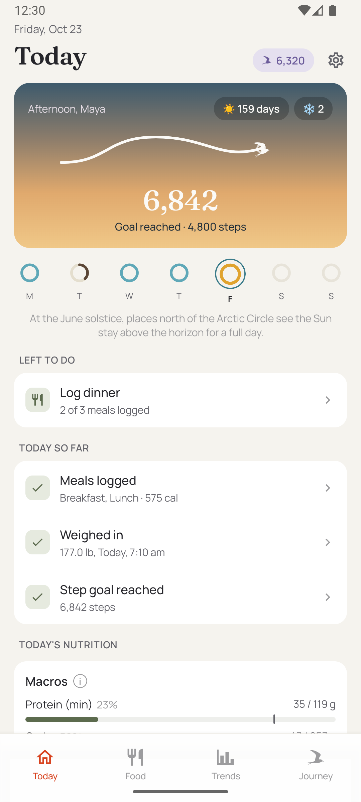
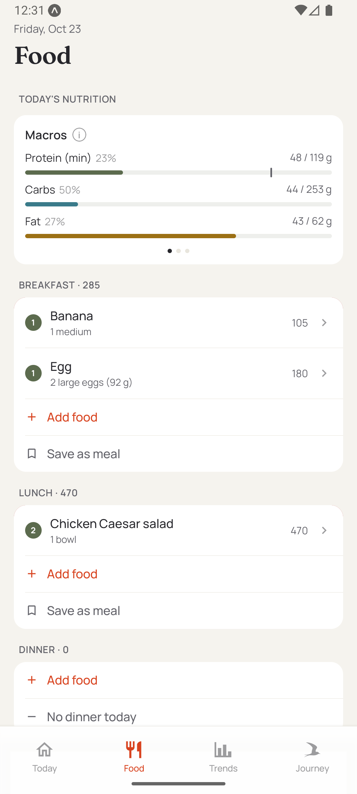
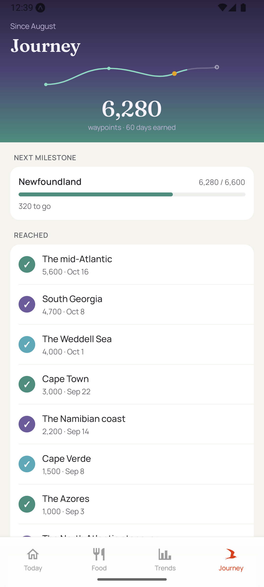
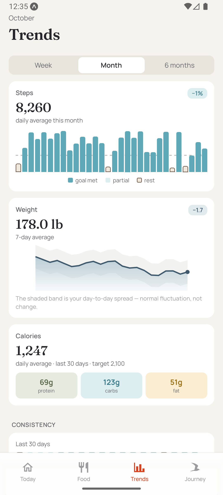

# Tern

**Progress answers to your pace.**

[](https://github.com/a-thread/tern/actions/workflows/ci.yml)


Tern is a health tracker built around movement and inspired by the Arctic tern, the bird with the longest regular migration on Earth. Each day you show up, your tern travels a little further along its journey.

Progress is measured in "Waypoints", which you earn by showing up for the habits YOU choose. As you keep at them, your tern moves along its route, reaching milestones on the way. Waypoints are never for your weight or calorie totals: a weigh-in earns the same whatever the scale says, and calorie totals don't earn or cost you anything.

|  |  |  |  |
| :-------------------------------------: | :------------------------------------: | :------------------------------------------: | :----------------------------------------: |
|                **Today**                |                **Food**                |                 **Journey**                  |                 **Trends**                 |

## Features

Track all the things that help you meet your goals:

- **Movement**
  - set a daily goal and connect Health Connect or Apple Health
  - log workouts and how hard they felt
  - take rest days that preserve your momentum
- **Food**
  - track calories, macros or neither!
    - nothing warns you for going over, and exercise never earns food back
  - control how food is displayed:
    - foods get a NOVA processing level as information, never a judgment
    - decide whether to display NOVA processing numbers, colors or neither
    - hide calories so that numbers don't keep you from showing up
  - search everyday foods (USDA) and packaged products (Open Food Facts)
  - scan a barcode, save meals, or re-log yesterday's dinner in a tap
  - opt into check-ins after meals to see how each one leaves you feeling
- **Weight** (optional)
  - track daily, weekly or neither!
  - skip a weigh-in if you need to
  - gain, lose or hold steady: your log is there for whatever goal you set
- **Water** (optional)
  - customizable daily goal tracking
  - reminders on a schedule that suits you
- **Mood and stress** (optional)
  - a quick daily check-in to see how you're doing over time
- **Medication** (optional)
  - add as many as you need
  - customize timing to daily or weekly
  - control reminders
- **Waypoints for showing up**
  - earned for showing up for the habits you choose
  - reach the Weddell Sea and your tern heads home, then sets off again, so the journey never ends
- **Your data is yours**
  - no ads, nothing sold
  - no account required: stay anonymous and keep everything on your device
  - create an account with Tern Plus to keep your data on a secure server
  - export everything, or delete it any time

## Tech stack

| Layer      | Choice                                                                                              |
| ---------- | --------------------------------------------------------------------------------------------------- |
| App        | [Expo](https://expo.dev) SDK 54, React Native 0.81, React 19, TypeScript                            |
| Navigation | React Navigation 7 (bottom tabs + native stack)                                                     |
| Backend    | [Supabase](https://supabase.com) (Postgres, auth, row-level security)                               |
| Steps      | Health Connect (`react-native-health-connect`), Apple Health (`@kingstinct/react-native-healthkit`) |
| Food data  | Open Food Facts, USDA FoodData Central                                                              |
| Purchases  | [RevenueCat](https://www.revenuecat.com) (`react-native-purchases`)                                 |
| Tests      | Jest, `jest-expo`, React Native Testing Library                                                     |
| Builds     | EAS Build, triggered from GitHub Actions                                                            |

With no Supabase keys the app runs against an in-memory backend seeded with sample data,
so you can work on the UI without setting anything up.

## Getting started

**Prerequisites:** Node (the version in [.node-version](.node-version)), and either the
[Expo Go](https://expo.dev/go) app or an Android emulator.

```bash
git clone https://github.com/a-thread/tern.git
cd tern
npm install
cp .env.example .env   # optional, see Configuration
npx expo start
```

Scan the QR code with Expo Go, or press `a` to open an Android emulator.

Health steps need a development client instead of Expo Go: Health Connect on Android
([docs/health-connect.md](docs/health-connect.md)), Apple Health on iPhone
([docs/healthkit.md](docs/healthkit.md)).

## Configuration

Copy [.env.example](.env.example) to `.env` (gitignored). Every variable is optional.

| Variable                                          | Purpose                                                                 |
| ------------------------------------------------- | ----------------------------------------------------------------------- |
| `EXPO_PUBLIC_SUPABASE_URL`                        | Supabase project URL. Blank runs on local sample data.                  |
| `EXPO_PUBLIC_SUPABASE_ANON_KEY`                   | Supabase anon key. Safe to ship, since RLS protects the data.           |
| `EXPO_PUBLIC_HEALTH`                              | Set to `1` in a dev build to read Health Connect or Apple Health.       |
| `EXPO_PUBLIC_USDA_API_KEY`                        | Enables everyday-food search. Blank falls back to Open Food Facts.      |
| `EXPO_PUBLIC_REVENUECAT_ANDROID_KEY` / `_IOS_KEY` | Tern Plus through RevenueCat (dev build). Blank simulates buying, free. |

To run against your own backend, follow [supabase/README.md](supabase/README.md) to create
a project and apply the migrations in [supabase/migrations/](supabase/migrations).

## Scripts

| Command              | What it does                   |
| -------------------- | ------------------------------ |
| `npm start`          | Start the Expo dev server      |
| `npm run android`    | Start and open on Android      |
| `npm run typecheck`  | Type-check with `tsc --noEmit` |
| `npm run lint`       | Lint with ESLint               |
| `npm test`           | Run the Jest suite             |
| `npm run test:watch` | Run Jest in watch mode         |

## Project layout

Code is organised by screen: each tab or flow has a folder holding its screens, and each
component holds the pieces only it uses. Data and rules shared across tabs are in `domain/`,
generic UI and helpers in `shared/`. Imports are relative up to two levels (`../../x`); `shared/` is always `@shared/…`, and anything else further away is `@/…` (both aliases point into `src`). The rules are in
[CLAUDE.md](CLAUDE.md) and [docs/architecture.md](docs/architecture.md#layout).

```text
App.tsx          fonts, providers, navigation
src/
  navigation/    the root navigator and route types
  today/ food/ trends/ journey/ settings/ auth/    one folder per tab or flow, screens inside
  movement/ check-in/ log-weight/                  modal flows
  domain/        Contexts, repositories and models used across tabs
  shared/        theme tokens, UI components, hooks, helpers
supabase/        migrations and setup
docs/            architecture, design, release notes, hosted store pages
```

The full tour is in [docs/architecture.md](docs/architecture.md).

## Continuous integration

Workflows live in [.github/workflows/](.github/workflows).

- **[CI](.github/workflows/ci.yml)** runs typecheck, lint and tests on every pull request
  and on pushes to `main`.
- **[Build](.github/workflows/build.yml)** runs CI, then starts an EAS build. Push a
  `v*` tag for a production build, or run it manually from the Actions tab for an
  installable `preview` APK.

Release steps and required secrets are in [docs/RELEASING.md](docs/RELEASING.md).

## Contributing

Issues and pull requests are welcome. Tern isn't open source: by opening a pull request
you agree to the contribution terms in [LICENSE](LICENSE).

1. Fork the repo and create a branch from `main`.
2. Make your change, with tests where the logic is pure (`models/` is the usual place).
3. Run `npm run typecheck && npm run lint && npm test`. CI runs the same three.
4. Open a pull request describing what changed and why.

Before touching anything the user sees, read [docs/design.md](docs/design.md). It sets the
palette rule and the earning rules, and the central one is that **waypoints reward
behavior, never weight or calorie totals**.

## Documentation

| Document                                         | What's in it                                              |
| ------------------------------------------------ | --------------------------------------------------------- |
| [docs/](docs/README.md)                          | the index, and the pages hosted for the store listing     |
| [docs/architecture.md](docs/architecture.md)     | folder layout, repositories, the waypoints ledger, schema |
| [docs/design.md](docs/design.md)                 | the palette rule, design commitments, earning rules       |
| [docs/health-connect.md](docs/health-connect.md) | turning on Android steps, what's configured               |
| [docs/food-search.md](docs/food-search.md)       | Open Food Facts and USDA, caching, attribution            |
| [supabase/README.md](supabase/README.md)         | setting up a project, migrations, what each table holds   |
| [docs/RELEASING.md](docs/RELEASING.md)           | EAS builds, the GitHub workflow, submitting to Play       |

## Status

Android is the tested platform. iPhone support (Apple Health steps and workouts, EAS iOS profiles) is in
the code and config but hasn't run on a real iPhone yet; see [docs/healthkit.md](docs/healthkit.md) for
what is verified and what is waiting on an Apple Developer account.
Tern is a tracking tool, not medical advice.

## License

© 2026 Aiden Threadgoode. All rights reserved. The code is published to read, not to
reuse; see [LICENSE](LICENSE). Dependencies and food data keep their own licenses.
